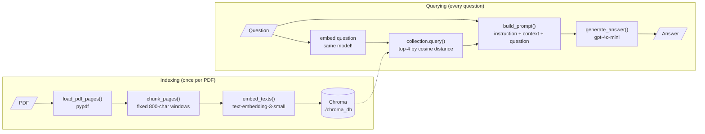
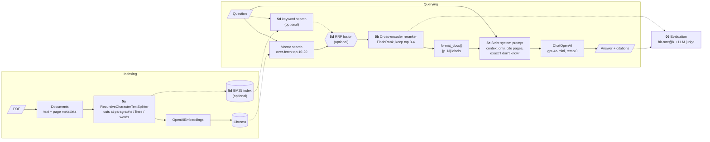

# RAG pipeline diagrams

GitHub renders these Mermaid diagrams automatically. In VS Code, install the
"Markdown Preview Mermaid Support" extension.

Every RAG system has two phases:
- **Indexing** (offline, once per document): turn documents into searchable vectors.
- **Querying** (online, every question): find the relevant pieces and answer from them.

## 1. Naive RAG (step 04)

What you build by hand in plain Python.

## 2. Improved RAG (after step 05)

Each upgraded stage is labelled with the sub-step that introduces it. The
dashed hybrid branch is the theory from 5d and isn't implemented in the main
scripts.

## How the steps map onto the pipeline

| Pipeline stage | Naive (04) | Improved (05+) | How we measure it (06) |
|---|---|---|---|
| Chunk | Fixed-size windows | Recursive splitter | Indirectly, via hit-rate |
| Retrieve | Top-k vector search | Over-fetch + rerank (+ hybrid) | **Hit-rate@k** |
| Prompt | "Use only the context" | Rules, citations, exact refusal | **Answer accuracy** |
| Generate | `gpt-4o-mini` | `gpt-4o-mini`, temperature 0 | **Answer accuracy** |
